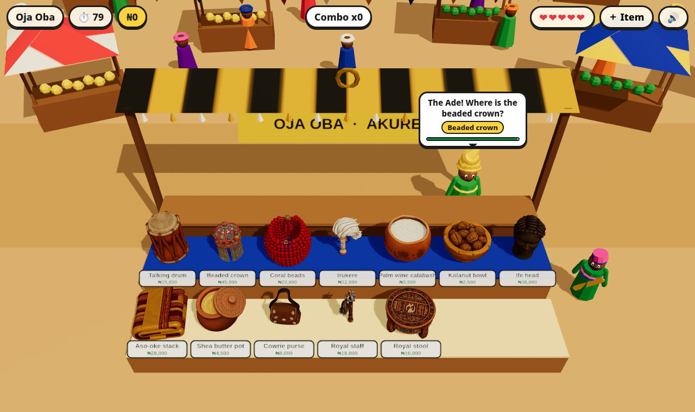

# Naija Market Rush

A funny browser game set in a busy Nigerian market. You run a stall. Customers shout what they want ("Abeg, bring me yam!", "Where's my agbada?!") and you tap the right item before their patience runs out. Some will **haggle**. Bank your naira, upgrade the stall, and unlock two more markets: **Oja Oba** (Akure king's market) and a lantern-lit **Night Market**. Snap a photo or type a prompt, and **Aholo Lux3D** turns it into a 3D item that lands on your shelf, ready to sell.

Entry for the **Manycore Aholo Global 3D AI Hackathon** (Gaming). Deadline 19 Nov 2026.



## Status (be honest about what is real)

| Part | Status |
|---|---|
| Playable game (Three.js, three markets, haggling mini-game, stall upgrades, combo, tips, VIP + per-level customer types, reputation, rush hour, mobile tap controls, procedural afrobeat-ish music + SFX, mute saved) | ✅ Built and smoke-tested headless |
| Three markets with level select (unlocks by stars) | ✅ Mama Jo Stall (always open), Oja Oba (1 star on stall), Night Market (1 star on Oja Oba, faster customers, lantern lighting) |
| Haggling mini-game | ✅ Some customers open a timing-bar; too high and they walk, a gold-zone deal earns a bonus |
| Stall shop (localStorage `nmr-save-v1`) | ✅ Faster hands, bigger shelf (14 slots), apprentice auto-serve, finer canopy — paid with banked naira |
| Item pipeline: `web/public/assets/manifest.json` + `*.glb` files | ✅ Built. **All 36 shelf items (12 per market) are real Aholo Lux3D text-to-3D GLBs** (G1-Turbo, cartoon, target 30k faces), compressed with gltf-transform (Draco + WebP 1024px) under `web/public/assets/models/`. See `docs/lux3d_generation_log.json` and `docs/LUX3D_ASSETS.md`. |
| "Make an item" → Lux3D API (photo → image-to-3D, prompt → text-to-3D) via `server/app.py` | ✅ Tested against the live Global API (not mock). In-game generation of a "Tomato basket" from a text prompt succeeded in 168.4 s and loaded on the shelf (task 8012442). |
| "Import a Lux3D .glb" (drag a GLB exported from the Lux3D web app) | ✅ Works on any static host, tested with a sample GLB |
| Sound | ✅ Procedural WebAudio SFX + 100 BPM afrobeat-ish loop, no third-party samples. Sources and licence: `docs/AUDIO_CREDITS.md` (CC0 1.0). Mute toggle persisted. |
| Market scenery from Lux3D (`scenery` in manifest) | ✅ Loader ready; procedural neighbour stalls (and night lanterns / palace silhouette) are shown until GLBs exist |

## Play it

Public demo (static Vite build on Vercel): **https://naija-market-rush.vercel.app**

Video demo: **https://youtu.be/vcnjE9VIMbM**

X (Twitter) post: **https://x.com/JosephJBassey/status/2122005022258942365**

Source: **https://github.com/Josephjbassey/naija-market-rush**

The public host serves the 36 shipped catalog GLBs. Live in-game Lux3D generation is **not** enabled there: the `AHOLO_API_KEY` is not in the frontend or in the public deploy. When the FastAPI backend is absent, the Generate control is hidden and the UI shows “Live generation available in local/server build.” Importing a GLB still works. To generate live, run the local backend below.

## Run it

```bash
# game only (static)
cd web && npm install && npm run dev          # http://localhost:5173

# game + Lux3D backend
python -m venv .venv && . .venv/bin/activate
pip install -r server/requirements.txt
cd web && npm run build && cd ..
export AHOLO_API_KEY=...        # Global key from https://3d.aholo.ai (never commit it)
python server/app.py            # http://localhost:8000  (serves web/dist + /api/*)
# no key yet?  LUX3D_MOCK=1 python server/app.py   -> fake purple cube, no credits used
```

During `npm run dev`, Vite proxies `/api` to `localhost:8000`. If the frontend is hosted separately (e.g. Vercel), build it with `VITE_API_BASE=https://your-backend` and set `CORS_ORIGINS` on the server.

Tests: `python tests/smoke.py http://localhost:4173 docs/screenshots path/to/any.glb` and `python tools/nmr_expand_test.py http://localhost:4173 docs/screenshots` (after `npm run build && npx vite preview`) and `LUX3D_MOCK=1 python server/app.py` + `python tests/mock_make.py http://localhost:8000`.

## Add Lux3D assets

1. Generate each item in Lux3D (web app at https://3d.aholo.ai, or the API). Prompts and photo tips: [docs/LUX3D_ASSETS.md](docs/LUX3D_ASSETS.md).
2. Download the **GLB**. Keep it light for the browser: aim for 20k–50k faces, under ~8 MB.
3. Save it as `web/public/assets/models/<filename from manifest.json>` (e.g. `models/yam.glb`). The game auto-scales and centres it; the "placeholder" tag disappears from that item's label.
4. Scenery props go in `web/public/assets/env/` (names in the `scenery` list). Each one found hides a procedural neighbour stall.
5. Reload. The start screen reports how many items are real Lux3D models vs placeholders.

To add a brand new item, add an entry under the right market in `levels` in `manifest.json` (`id`, `name`, `price` in naira, `glb`, `requests` lines). The shelf holds 12 items, or 14 with the bigger-shelf upgrade; extras made in-game replace the oldest slot.

## Architecture

```
web/  (Vite + Three.js, static build)
  src/main.js         game loop, serving, haggling, shop, level select, scoring, input
  src/levels.js       three markets: pacing, unlocks, star thresholds, customer types
  src/progress.js     localStorage bank, stars, upgrades, mute
  src/world.js        day / royal / night themes, stall, lanterns, canopy upgrade, crowd
  src/items.js        manifest loader, GLTFLoader (+Draco), auto-normalise, placeholder fallback
  src/placeholders.js procedural PLACEHOLDER meshes (until a GLB exists)
  src/customers.js    per-level types (chief, geleQueen, okada, hawker, nightowl, …)
  src/maker.js        "Make an item": Lux3D generate (backend) or GLB import
  src/audio.js        procedural WebAudio SFX + afrobeat-ish loop (no audio files)
  public/assets/      manifest.json + 36 Lux3D GLBs
server/app.py         FastAPI: /api/make -> Lux3D create (official SDK, Global region "com"),
                      /api/task/{id} -> poll + download GLB (cached; output URLs expire ~2 h),
                      /api/glb/{id}, serves web/dist. Rate limit (MAX_GENERATIONS_PER_HOUR).
modelscope/app.py     ModelScope Studio (Gradio SDK) entry: same server on port 7860
scripts/build_modelscope.sh  assembles build/modelscope/
```

Lux3D API used: `POST https://api.aholo.ai/global/lux3d/v1/generate/img-to-3d/task/create` (photo sent as a data URL) and `.../text-to-3d/task/create`, then `GET .../generate/task/get?taskid=` until `status=3`. Header `Authorization: <key>` (no Bearer). Defaults: `version=G1-Turbo`, `outputFormat=["glb"]`, `faceCount=30000`, text style `cartoon`. Docs: https://lux3d.aholo.ai/docs

## Hosting

- **Vercel (static, public demo live):** https://naija-market-rush.vercel.app — project root `web`, framework Vite, build `npm run build`, output `dist`. Team `josephjbasseys-projects`. Only the project alias is public; unique deployment URLs use Vercel Authentication. "Import a Lux3D .glb" works; "Generate with Lux3D" is hidden on this host (no backend, no API key).
- **ModelScope Studio (recommended by the organisers):** run `scripts/build_modelscope.sh`, create a **Gradio** Studio on modelscope.ai, push `build/modelscope/`, add `AHOLO_API_KEY` as a Studio secret. Or a **Static** Studio with just `build/modelscope/dist/`. (The ModelScope deploy itself has not been tested yet.)

## Credits & tools

Three.js, Vite, FastAPI, Aholo Lux3D (3D assets + API, `manycore-aholo-sdk-lux3d`), Gradio (ModelScope wrapper). Made by Joseph Bassey John.
